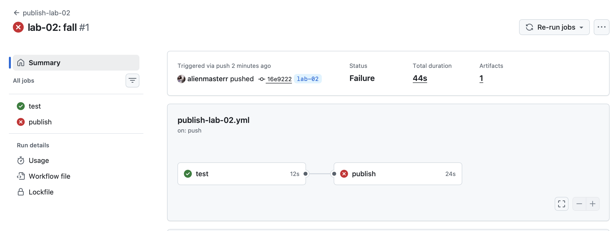
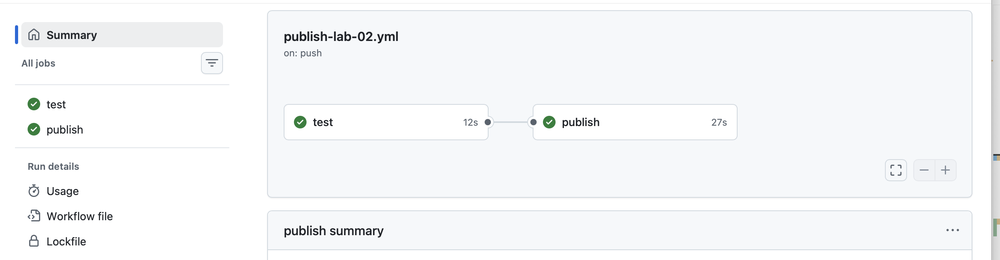
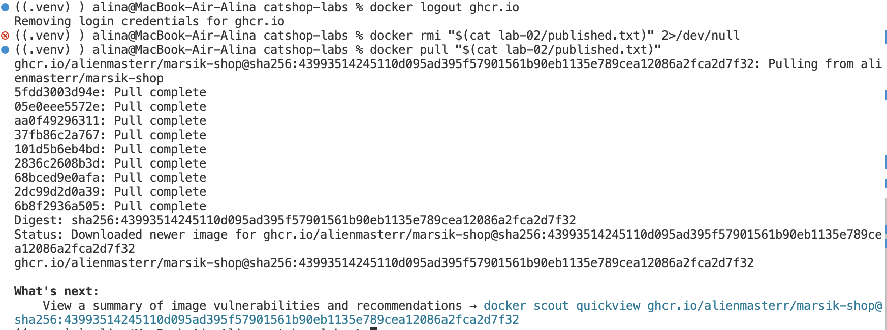
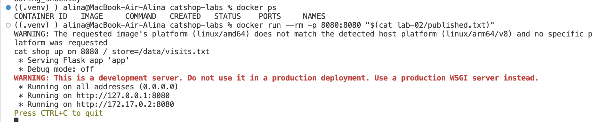
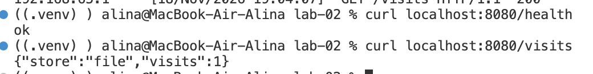
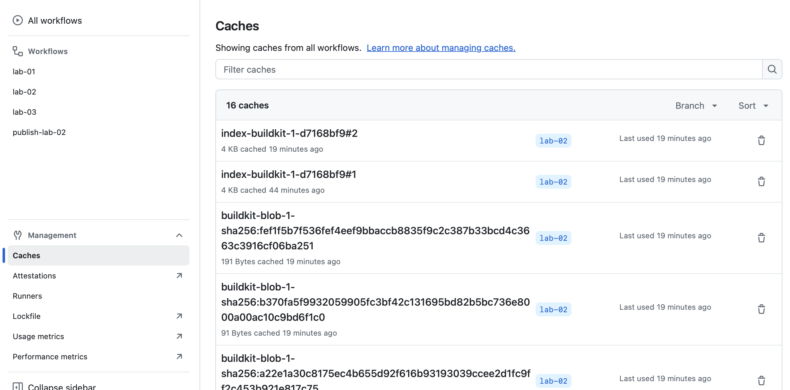
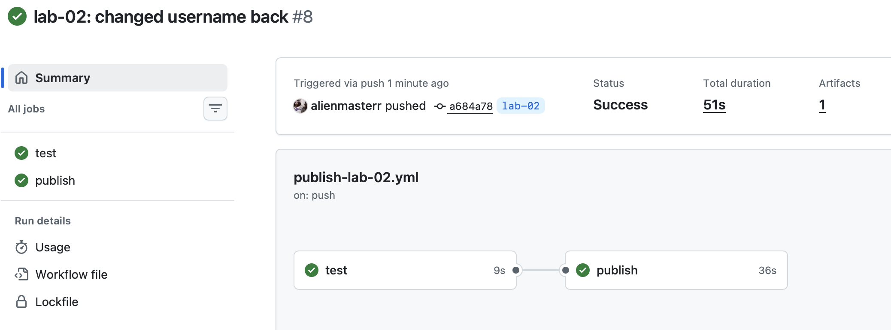

# return "ok\n"

((.venv) ) alina@MacBook-Air-Alina lab-02 % time ./.venv/bin/python -m pytest tests -q
.......                                                                                                            [100%]
7 passed, 1 warning in 0.03s
./.venv/bin/python -m pytest tests -q  0.35s user 0.10s system 38% cpu 1.167 total

# return "OK\n"

E       AssertionError: assert 'OK\n' == 'ok\n'
E         
E         - ok
E         + OK
FAILED tests/test_health.py::test_health_body_and_status - AssertionError: assert 'OK\n' == 'ok\n'
1 failed, 6 passed, 1 warning in 0.10s

time on 7 tests ±0.34s

((.venv) ) alina@MacBook-Air-Alina catshop-labs % curl localhost:8080/health
ok
((.venv) ) alina@MacBook-Air-Alina catshop-labs % curl localhost:8080/visits
{"store":"file","visits":1}

# no write in permissions job publish
    permissions:
      contents: read
      packages: write

buildx failed with: ERROR: failed to build: failed to solve: failed to push ghcr.io/alienmasterr/marsik-shop:sha-16e922278a448de4f18971b7bf878ce0fc6bdcda: denied: installation not allowed to Create organization package

# added packages: write in permissions job publish

why: GITHUB_TOKEN exists always, but by default it has only reading permit. writing into packages must be allowed additionally

my workflow listens only push in lab-02, that's why on PR from fork it does not react. if through pull_request, token would be read-only and without secrets, so publish would fall, because other code shall not publish from my name

second push will overwrite the tag (tag is movable), and someone who pulls by this tag will get another image. with sha-tag this happens only when rerunning the same commit, and then image still can be different, because build does not guarantee by bit reproducibility

digest copied manually from the step output. in real production, it's easy to paste the wrong digest or forget to update it after a new build.
tag is a movable pointer, digest is a hash of specific content. it may happen that someone pushed the tag again, and after restart prod pulled different code. same tag, but different image.
anyone can pull public package without authentication, while private one can be pulled only by added pepple

cache

cleaned cache: 22s vs 14s

